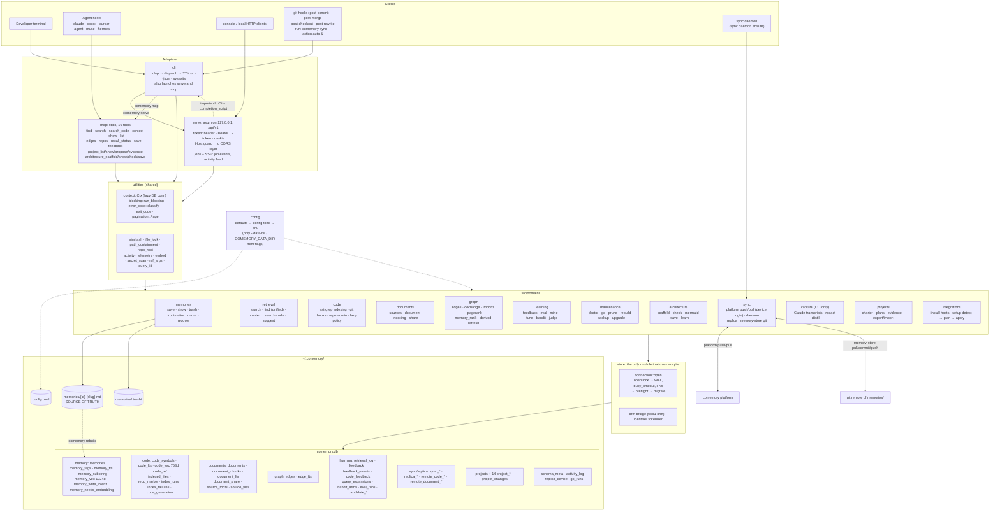
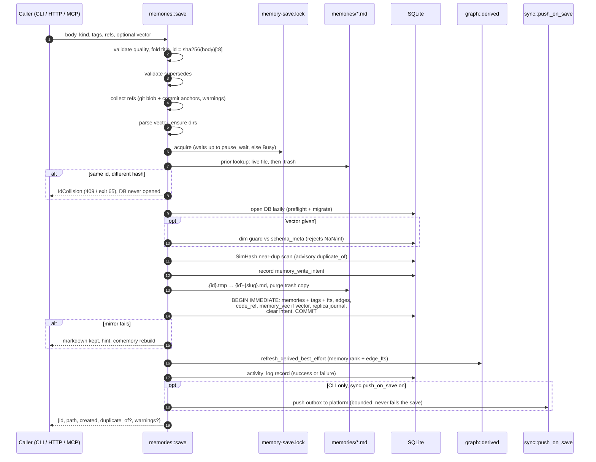
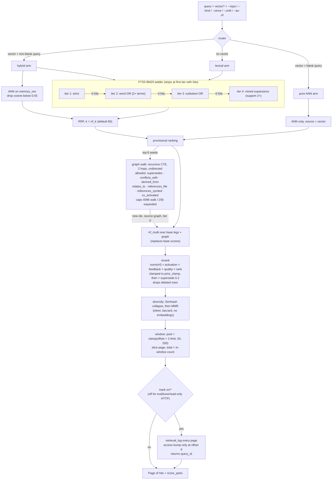
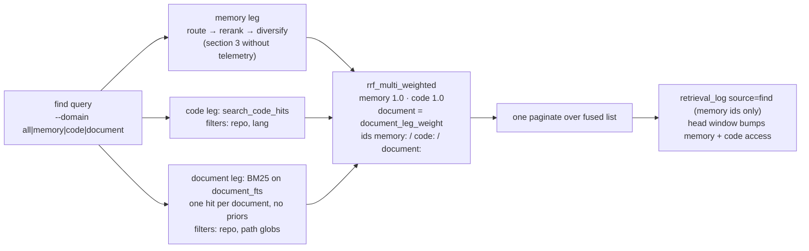
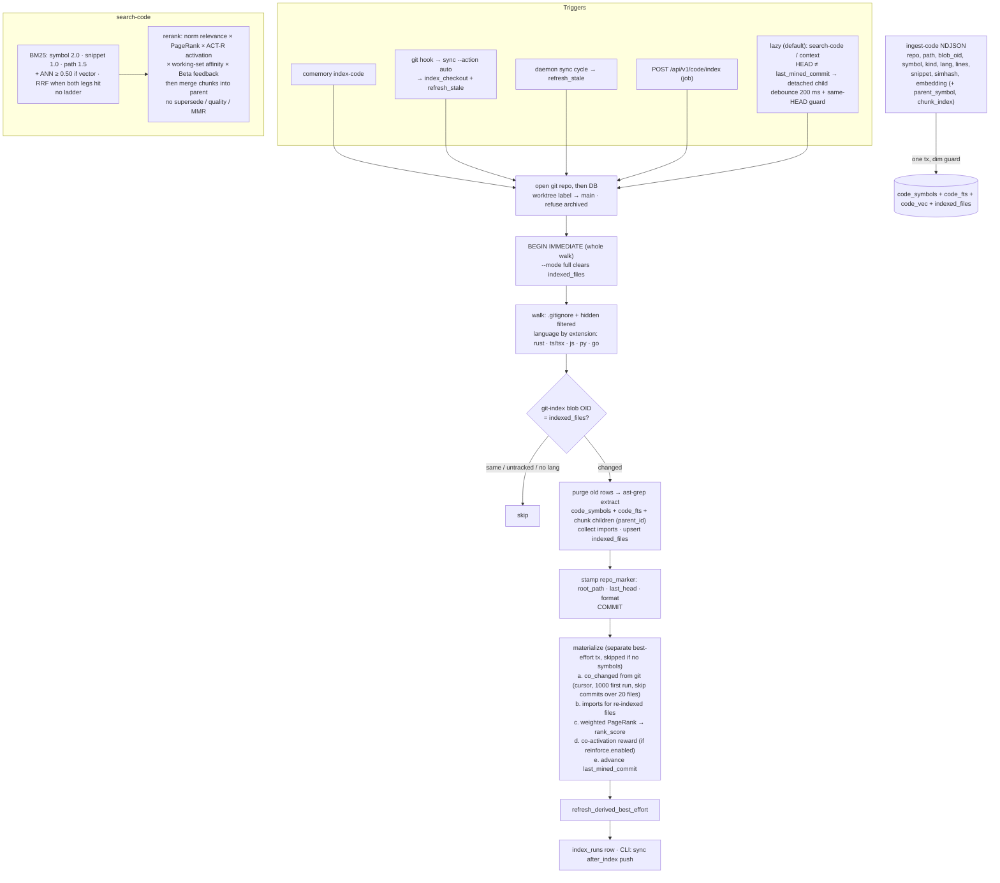

# Architecture diagrams

Mermaid views of how comemory is put together, checked against the source at
`v0.59.0` (`0c35b097`). [Architecture](architecture.md) is the prose
explanation; these diagrams are the map. Where the two disagree, the code
wins. The [known drift](#known-drift-in-architecturemd) section at the end
lists every place this was the case when the diagrams were drawn.

1. [Components and storage](#1-components-and-storage)
2. [Save flow](#2-save-flow)
3. [Memory search pipeline](#3-memory-search-pipeline)
4. [`find`: the unified search](#4-find-the-unified-search)
5. [Code indexing](#5-code-indexing)

## 1. Components and storage

Three delivery adapters run the same command cores. `mcp` imports neither of
the others; `serve` borrows the clap `Cli` type from `cli` for its
completion and meta routes; `cli` launches both as subcommands. Only `store`
names `rusqlite`.

## 2. Save flow

The order the code runs in (`src/domains/memories/save.rs`,
`save_persist.rs`). The lock is taken before the prior lookup, and the
database is opened only after it, so an id collision never opens or migrates
the database. Save never runs git; the CLI alone pushes to the platform.

## 3. Memory search pipeline

`search`, `context`, and the memory leg of `find` (`src/domains/retrieval/`).
The lexical ladder runs in both the lexical and hybrid arms. When the graph
leg fires, it re-fuses every leg, so base scores change too.

## 4. `find`: the unified search

`find` is the default MCP recall tool. It is not the pipeline above end to
end: it runs up to three legs at one pool size and fuses them
(`src/domains/retrieval/unified/`). Time and kind filters reach only the
memory leg.

## 5. Code indexing

Every trigger ends in `index_code::run` (`src/domains/code/index_code.rs`).
The file walk is one transaction. Graph mining is a separate best-effort
transaction after it. `last_head` is stamped inside the walk;
`last_mined_commit`, which the lazy check reads, advances at the end of
mining.

## Known drift in architecture.md

When these diagrams were drawn, `architecture.md` disagreed with the code in
these places:

- §2 lists config layering as ending in "CLI flags"; `cli::load_config` is
  defaults → file → env, and only `--data-dir` comes from a flag.
- §6 step 5 says save runs `git add + commit + push` under
  `COMEMORY_GIT_AUTO_SYNC`; save never runs git (`[git] auto_sync` is read
  only by `comemory sync`'s memory-store flow), and the CLI pushes to the
  platform through `sync::push_on_save`.
- §7 says one transaction per file; the walk is one transaction, and graph
  mining runs in a second one.
- §7 gives `ingest-code` rows as `{qualified, snippet, embedding}`; the real
  row has eleven required fields and rejects unknown ones.
- §8 says the git hooks run `index-code`; there are four hooks
  (`post-rewrite` included) and they run `comemory sync --action auto`.
